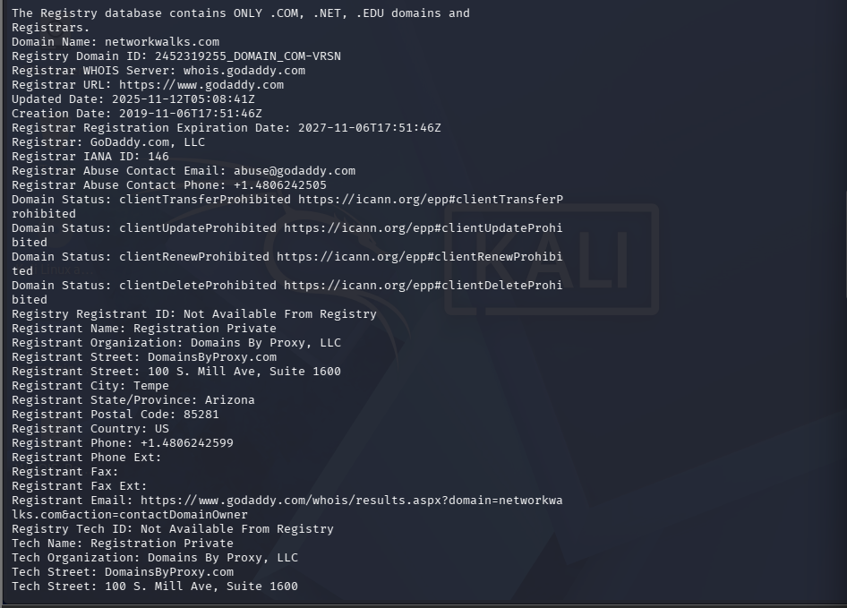
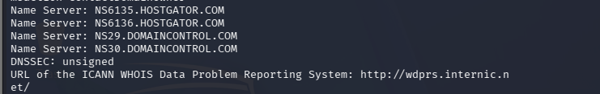
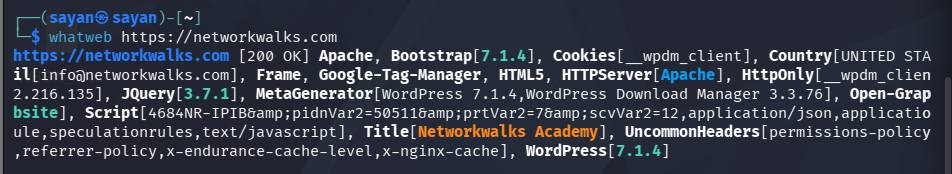
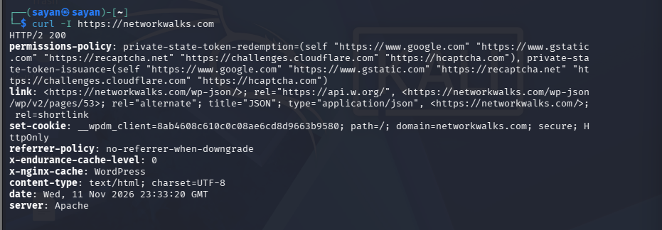
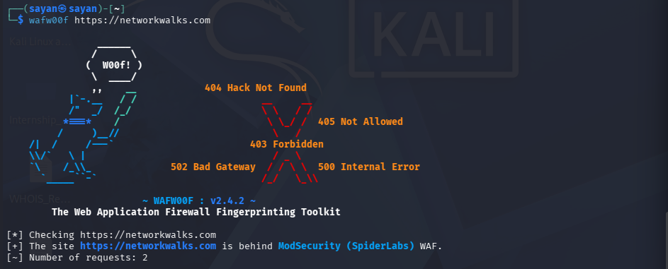
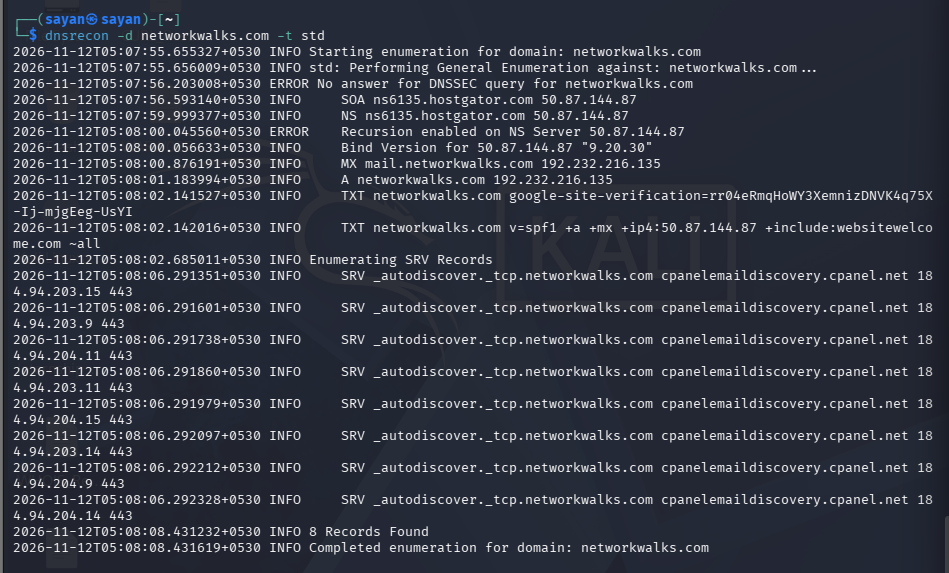
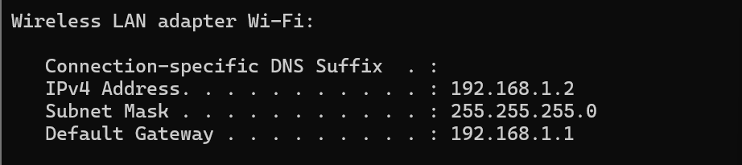
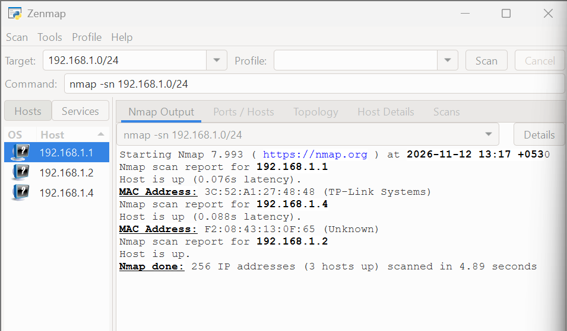
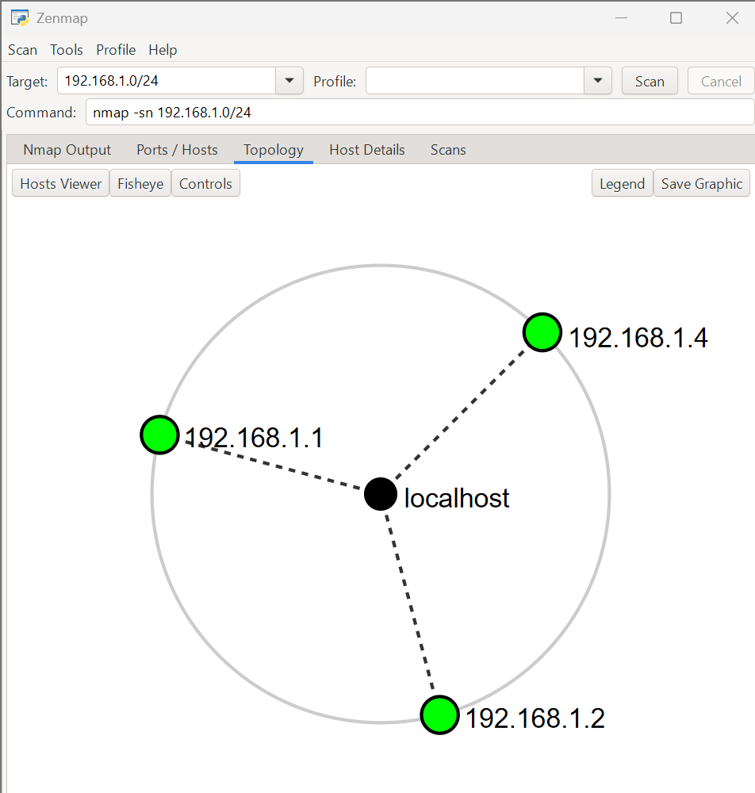

# PENETRATION TESTING REPORT

## FOOTPRINTING & NETWORK SCANNING PHASES

**W2-PM-FINAL | CYBERSECURITY | NETWORKWALKS**

| Field                           | Details                                                                                                                                              |
| ------------------------------- | ---------------------------------------------------------------------------------------------------------------------------------------------------- |
| Pentester Name                  | Sayan Dalal (Cybersecurity Intern)                                                                                                                   |
| Program/Batch                   | B084 - Networkwalks                                                                                                                                  |
| Date                            | 12 November 2026                                                                                                                                     |
| Modules completed               | W2-PM1 (Multiple Kali Tools) W2-PM5 (Zenmap Scanning)                                                                                             |
| Client / Target                 | 1. networkwalks.com (internship-assigned domain) 2. Own home Wi-Fi LAN: `192.168.1.0/24`                                                          |
| Permission secured from client? | Domain named in internship assignment; independent written permission not verified for this report. Local LAN identified as user-owned home network. |
| Phases covered                  | Phase 1: Reconnaissance & Footprinting Phase 2: Scanning & Network Discovery Phases 3-5: Not performed                                         |

## 1. Liability Disclaimer

The activities described in this report were performed for educational purposes in the Networkwalks Week 2 internship. Domain lookups and technology identification were limited to the internship-assigned domain; local host discovery was performed on the participant's home network. The author must ensure that all testing is within the permission granted by the relevant owner. No exploitation, credential attacks, port scanning, or vulnerability validation was performed. Findings are observations, not proof of exploitable vulnerabilities. Unauthorized access or scanning outside permitted scope may violate applicable laws and policies.

## 2. Introduction

This report documents two Week 2 practical modules: W2-PM1, public-facing footprinting of networkwalks.com using six Kali Linux tools; and W2-PM5, local network discovery using Zenmap on a Windows HP laptop. Together, these exercises demonstrate the progression from publicly available domain and web information to visibility of active devices on a personally controlled LAN.

For each activity, the report records the command used, observed result, supporting evidence, and relevance to security assessment. The web observations were captured on 11-12 November 2026, and the Zenmap scan on 12 November 2026. Results are time-specific and may change.

## 3. Tools Used

| Tool                 | Purpose                                                                |
| -------------------- | ---------------------------------------------------------------------- |
| Kali Linux & Windows | Operating systems for reconnaissance and network discovery.            |
| WHOIS                | Identify registrar, registration dates and authoritative name servers. |
| WhatWeb              | Fingerprint website technologies and software indicators.              |
| nslookup             | Resolve domain to IPv4 address using DNS.                              |
| curl -I              | Inspect HTTP response headers.                                         |
| wafw00f              | Fingerprint presence and type of web application firewall.             |
| dnsrecon             | Enumerate DNS records and related metadata.                            |
| Zenmap (Nmap GUI)    | Discover responsive hosts and display local network topology.          |
| Windows CMD          | Identify local IPv4 address, subnet mask and gateway.                  |

## 4. Activities Performed

### 4.1 Footprinting & Reconnaissance

Target: networkwalks.com. The following commands were executed from Kali Linux. Results below reflect the provided terminal captures and saved observations.

**WHOIS:** `whois networkwalks.com`. The registrar was GoDaddy.com, LLC; creation date 6 November 2019; expiry date 6 November 2027. Four listed name servers included NS6135/NS6136.HOSTGATOR.COM and NS29/NS30.DOMAINCONTROL.COM. The registrant was privacy-protected and DNSSEC was reported unsigned.

**WhatWeb:** `whatweb https://networkwalks.com`. The website returned HTTP 200 and reported Apache, WordPress 7.1.4, WordPress Download Manager 3.3.76, jQuery 3.7.1 and IP 192.232.216.135. These are tool detections, not independently confirmed version inventories.

**NSLOOKUP:** `nslookup networkwalks.com`. Resolver 8.8.8.8 returned A record 192.232.216.135, consistent with WhatWeb.

**CURL:** `curl -I https://networkwalks.com`. HTTP/2 200, Apache server, text/html content type, a WordPress REST API link, and a cookie with Secure and HttpOnly attributes were observed. The referrer policy was no-referrer-when-downgrade.

**WAFW00F:** `wafw00f https://networkwalks.com`. Version 2.4.2 reported ModSecurity (SpiderLabs) WAF after two requests; detection does not verify configuration or effectiveness.

**DNSRecon:** `dnsrecon -d networkwalks.com -t std`. SOA/NS ns6135.hostgator.com (50.87.144.87), MX mail.networkwalks.com, A 192.232.216.135, SPF and site-verification TXT records, and eight autodiscover SRV records were reported. DNSRecon flagged recursion enabled on 50.87.144.87 and received no answer to a DNSSEC query; both require context or authorized verification before security conclusions.

### 4.2 Network Scanning with Zenmap

On the Windows HP laptop, `ipconfig` identified IPv4 192.168.1.2, subnet mask 255.255.255.0 (/24) and default gateway 192.168.1.1. The user confirmed this was their home Wi-Fi network. In Zenmap, the command `nmap -sn 192.168.1.0/24` performed host discovery only, without port scanning.

The scan covered 256 addresses and reported three active hosts in 4.89 seconds. Zenmap displayed two MAC addresses; the local host MAC was not reported. A topology diagram was exported to PDF and retained as a separate deliverable.

| IP address  | Observed MAC address | Identification              |
| ----------- | -------------------- | --------------------------- |
| 192.168.1.1 | 3C:52:A1:27:48:48    | TP-Link Systems (gateway)   |
| 192.168.1.4 | F2:08:43:13:0F:65    | Unknown vendor              |
| 192.168.1.2 | Not reported         | Windows laptop / local host |

The topology graphic depicts the three responding hosts relative to localhost. It is a discovery visualization and does not establish physical cable connections or the full network layout.

## 5. Risk Analysis / Impact

The table summarizes security-relevant observations. Risk levels are preliminary contextual ratings, not verified vulnerability severities.

| # | Risk / Finding               | Evidence / Observation                              | Potential Impact                                      | Level  |
| - | ---------------------------- | --------------------------------------------------- | ----------------------------------------------------- | ------ |
| 1 | Web technology information   | WhatWeb reports WordPress and plugin versions       | May help prioritize maintenance and authorized review | Low    |
| 2 | Server IP identifiable       | DNS and WhatWeb return 192.232.216.135              | Public web endpoint can be mapped                     | Low    |
| 3 | HTTP technical metadata      | Apache and WordPress API link in headers            | Reveals service characteristics                       | Low    |
| 4 | WAF fingerprint identifiable | WAFW00F reports ModSecurity                         | Exposes some defensive technology details             | Low    |
| 5 | DNS configuration review     | DNSRecon flags recursion; DNSSEC unsigned/no answer | Potential misconfiguration merits verification        | Review |
| 6 | Multiple local hosts visible | Zenmap found 3 hosts, including unknown vendor      | Inventory may contain unidentified devices            | Review |

Public IPs, DNS records, visible technologies and active devices are not vulnerabilities by themselves. The DNS recursion indication was not independently validated. No exploitation or vulnerability validation was carried out.

## 6. Recommendations

- Review publicly visible technology and plugin information; maintain an accurate asset inventory.
- Keep WordPress, plugins, Apache and related components updated against applicable advisories.
- Review HTTP response headers and cookie policies for appropriate security settings.
- Audit public DNS records, SPF policy and authoritative DNS settings; verify the recursion alert with an authorized administrator.
- Review DNSSEC deployment decisions and confirm authoritative DNS configuration.
- Keep ModSecurity configured, monitored and updated; detection alone does not establish protection quality.
- Periodically inventory authorized home or organizational LAN devices.
- Identify the 192.168.1.4 device through router administration or owner verification before treating it as suspicious.
- Maintain current network diagrams and conduct further tests only with explicit permission.

## 7. Conclusion

During Week 2 of the Networkwalks cybersecurity internship, I completed practical activities in reconnaissance, footprinting and network discovery. The first module showed how six complementary Kali Linux tools provide domain registration, website technology, DNS resolution, HTTP headers, WAF fingerprinting and service-record information. The observations were cross-checked where possible: WhatWeb, NSLOOKUP and DNSRecon all reported the same web IP address.

The second module used Windows ipconfig and Zenmap to identify the 192.168.1.0/24 home subnet and discover three responsive hosts, with two MAC addresses available. I generated and saved a PDF topology visualization to document the discovered network. These results demonstrate the value of accurate asset discovery while also showing the limits of a simple host-discovery scan: unresponsive devices may exist, and vendor names do not prove device identity.

Overall, I learned to connect technical output to a clear security narrative: what command was used, what was observed, why it matters, and what follow-up review is appropriate. I also learned that reporting must distinguish routine exposure from confirmed vulnerabilities and that all assessment work must remain within authorized scope. Screenshots and the original topology export are included as evidence of the completed exercises.

## 8. Evidences Collected

The following screenshots are original evidence supplied for this assessment, presented in task order. The exported Zenmap topology PDF is retained separately.

**Evidence 1A — WHOIS registration details**

**Evidence 1B — WHOIS name servers**

**Evidence 2 — WhatWeb fingerprinting**

**Evidence 3 — NSLOOKUP DNS resolution**

**Evidence 4 — CURL HTTP headers**

**Evidence 5 — WAFW00F detection**

**Evidence 6 — DNSRecon records and messages**

**Evidence 7 — Windows ipconfig**

**Evidence 8 — Zenmap host discovery**

**Evidence 9 — Zenmap topology**

Separate supporting file: `W2_PM5_Network_Topology.pdf` (Zenmap-exported topology).

---

**-End-**

## Author

Sayan Dalal | Networkwalks Cybersecurity Intern | Batch B084
